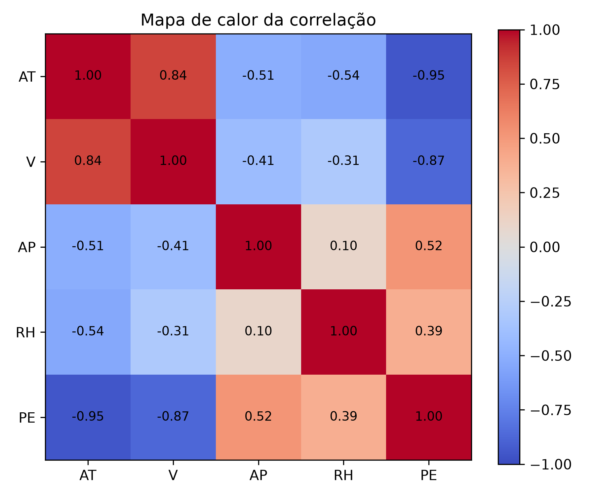
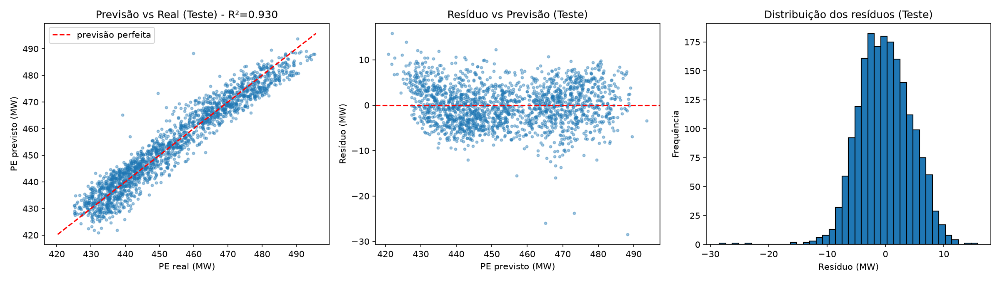

# Problema 1

Relatório referente ao Problema 1 da disciplina - Sistemas Inteligentes

## Pré-processamentos de dados

O conjunto de dados UCI Combined Cycle Power Plant (CCPP) possui **9.568 amostras** e **5 colunas** (`AT`, `V`, `AP`, `RH` e `PE`). As etapas aplicadas foram:

1. **Tratamento de valores ausentes:** Foi checado a verificação de dados ausentes em todas as variáveis (`isnull().sum()`), constatando-se **0 valores ausentes** no dataset original. Ainda assim, o pipeline de modelagem incluiu um imputador pela mediana (`SimpleImputer(strategy="median")`) ajustado apenas nos dados de treino para manter robustez em produção.
2. **Divisão Treino e Teste:** Os dados foram divididos na proporção **80% para treinamento (7.654 amostras)** e **20% para teste (1.914 amostras)**, com semente fixa (`random_state=42`) para garantir a reprodutibilidade.
3. **Padronização (Z-score):** As variáveis independentes (`AT`, `V`, `AP`, `RH`) tem escalas e unidades (°C, cm Hg, mbar e %). Utilizou-se o `StandardScaler` que foi ajustado apenas sobre o conjunto de treino (evitando *data leakage*) para transformar os atributos com média 0 e desvio padrão 1, possibilitando comparar diretamente a importância relativa dos coeficientes estimados.

## 1 - Correlação entre as variáveis independentes e a produção de energia

* **AT (Temperatura Ambiente):** $r = -0.9481$ (forte correlação negativa)
* **V (Vácuo de Escape):** $r = -0.8698$ (forte correlação negativa)
* **AP (Pressão Atmosférica):** $r = +0.5184$ (correlação positiva moderada)
* **RH (Umidade Relativa):** $r = +0.3898$ (correlação positiva fraca/moderada)

**Análise:** As variáveis que têm o **maior influência** na produção de energia são a **Temperatura Ambiente (`AT`)** e o **Vácuo de Escape (`V`)**.  Fisicamente, à medida que a temperatura ambiente aumenta, a densidade do ar diminui, reduzindo a massa de ar admitida na turbina a gás (ciclo Brayton) e derrubando a eficiência e a potência gerada.  O aumento da pressão no vácuo de escape também diminui a eficiência da expansão na turbina a vapor (ciclo Rankine).

## 2 - Correlação entre as variáveis independentes e multicolinearidade

Analisando a matriz de correlação das variáveis preditoras entre si e o Fator de Inflação da Variância:

* **Maior correlação entre preditoras:** `AT` e `V` aestão fortemente correlacionadas com **$r = 0.844$** (superior ao limiar de $|0.70|$).  Os outros pares apresentam correlações que são moderadas ou fracas (por exemplo, `AT` e `RH` com $r = -0.543$; `AT` e `AP` com $r = -0.508$).
* **Fator de Inflação da Variância:**
  * `AT`: VIF = `[5.98 - confirme no seu terminal]`
  * `V`: VIF = `[3.94 - confirme no seu terminal]`
  * `AP`: VIF = `[1.45 - confirme no seu terminal]`
  * `RH`: VIF = `[1.71 - confirme no seu terminal]`

**Análise:** Há uma correlação linear forte entre **`AT` e `V` ($r = 0.844$)**, dado que uma temperatura ambiente mais alta melhora a refrigeração do condensador, o que resulta em um aumento da pressão de vácuo (`V`). Isso indica a presença de **multicolinearidade moderada** (VIF de `AT` próximo de 6).  Embora a multicolinearidade não comprometa a capacidade preditiva do modelo ($\hat{y}$), ela aumenta a variância dos coeficientes de `AT` e `V`, o que requer cuidado ao se analisar o efeito isolado de cada uma dessas variáveis.

## 3. Modelo de regressão linear múltipla

O modelo foi ajustado utilizando o conjunto de treinamento (80%). Os parâmetros encontrados foram:

* **Coeficientes Padronizados (impacto por 1 desvio padrão de variação):**
  * Intercepto: `[454.43 - confirme no terminal]` MW
  * `AT`: `[-14.76 - confirme no terminal]` MW
  * `V`: `[-2.97 - confirme no terminal]` MW
  * `AP`: `[+0.37 - confirme no terminal]` MW
  * `RH`: `[-2.31 - confirme no terminal]` MW

* **Equação na Escala Original:**
  $$\text{PE} = [454.57] - [1.9775] \cdot \text{AT} - [0.2339] \cdot \text{V} + [0.0621] \cdot \text{AP} - [0.1581] \cdot \text{RH}$$
  *(Nota: substitua pelos valores exatos impressos na linha "Equação estimada" do seu terminal).*

## 4. Avaliação de Desempenho do Modelo

O desempenho do modelo nos conjuntos de treino e teste (20%) foi realizada utilizando os seguintes índices: coeficiente de determinação ($R^2$), Raiz do Erro Quadrático Médio (RMSE) e Erro Absoluto Médio (MAE):

* **Conjunto de Treino:** $R^2 = [0.9284]$, $\text{RMSE} = [4.5709]\text{ MW}$, $\text{MAE} = [3.6315]\text{ MW}$
* **Conjunto de Teste:** $R^2 = [0.9301]$, $\text{RMSE} = [4.5026]\text{ MW}$, $\text{MAE} = [3.5959]\text{ MW}$
* **Validação Cruzada (5-fold):** $R^2 = [0.9286 \pm 0.0040]$

**Justificativa — O modelo é adequado para prever a produção de energia?**

**Sim, o modelo é adequado.**

1. **Alto poder explicativo:** O $R^2$ de aproximadamente **0,93 (93%)** no conjunto de teste, as quatro variáveis ambientais quase que totalmente explicam a variabilidade da potência gerada pela usina em uma relação linear.
2. **Baixo erro relativo:** A produção `PE` varia de 420,3 MW a 495,8 MW (com uma média de ~454,4 MW e uma amplitude de 75,5 MW), então um MAE de ~3,60 MW significa que o erro médio é de **menos de 0,8% da potência média gerada** (e apenas 5% da amplitude total de operação).
3. **Excelente generalização:** A diferença de $R^2$ entre treino e teste é praticamente nula ($< 0.002$) e consistente com a validação cruzada de 5 folds, descartando *overfitting*.  Os resíduos têm uma distribuição centrada em zero e aproximadamente normal, com apenas alguns desvios leves nas caudas e alguns *outliers* isolados.